<!-- ==================== CUSTOM VECTOR HERO CARD ==================== -->
<div align="center">
  
</div>

<br/>

> **🔒 Read-Only Public Showcase:** This repository documents the architecture and workflow of a custom localhost data entry, billing, and Excel automation tool. Internal business records and production source code are kept private for data security.

---

### 🎯 Problem & Solution
Manual data entry and billing directly inside heavy Excel spreadsheets often leads to **formatting errors, accidental deletions, slow filtering, and repetitive work**. 

This system replaces manual spreadsheet entry with a **lightweight, integrated Python + HTML/CSS web interface running on `localhost`**. Every entry is securely stored in a single local **`database.db`** file, can be tracked/audited directly via **`sqlite.exe`**, and exported into clean **Excel (`.xlsx`) reports in 1 click**.

---

### ⚙️ System Architecture & Workflow

```mermaid
flowchart LR
    A["💻 Browser UI<br/>(HTML & CSS on Localhost)"] -->|Form / Billing Entry| B["🐍 Python Backend<br/>(Integrated Server)"]
    B -->|Read / Write| C[("🗄️ database.db<br/>(Local SQLite File)")]
    C -->|Direct Query & Audit| D["🔍 sqlite.exe<br/>(Local Tracking)"]
    B -->|1-Click Automation| E["📊 Excel Export<br/>(.xlsx Report Download)"]
